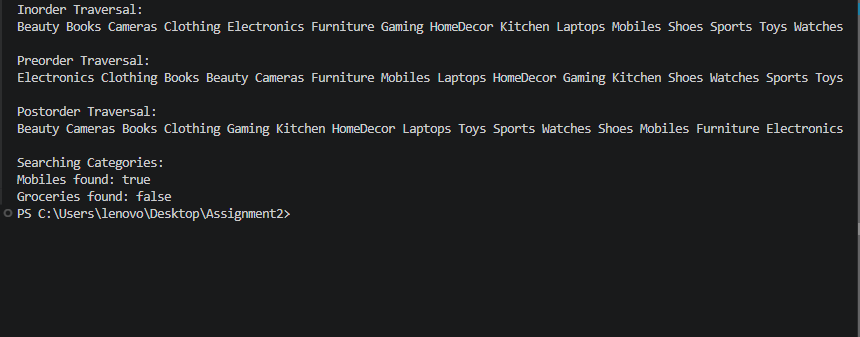
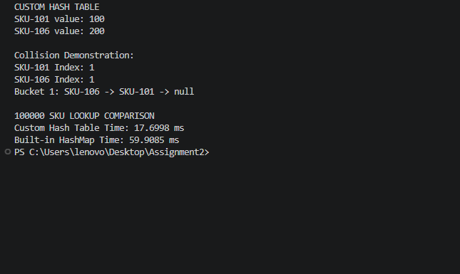
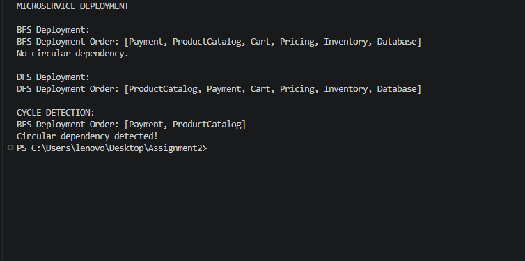

# E-Commerce Catalogue and Traffic Analysis

This repository contains five Java programs that apply data structures and algorithmic patterns to e-commerce scenarios.

## Project structure

```text
Assignment2/
├── README.md
└── ECommerceCatalogue/
    ├── DecisionTable.png.png
    ├── output1.png
    ├── output2.png
    ├── output3.png
    ├── output4.png
    ├── output5.png
    ├── GiftCardPairFinding/
    │   └── TwoPointers.java
    ├── MicroserviceDeployment/
    │   └── Graph.java
    ├── PeakTrafficAnalysis/
    │   └── SlidingWindow.java
    ├── ProductCategoryManagement/
    │   └── BinarySearchTree.java
    └── SKULookupComparison/
        └── HashTable.java
```

## Decision table

The accompanying decision table graphic is available at [DecisionTable.png.png](ECommerceCatalogue/DecisionTable.png.png).

## Source code and execution

The commands below are for PowerShell run from the repository root. They compile each source file into an `out` directory and run its fully qualified Java class. A JDK with `javac` and `java` on `PATH` is required.

### Product Category Management

Source: [BinarySearchTree.java](ECommerceCatalogue/ProductCategoryManagement/BinarySearchTree.java)

```powershell
javac -d out ECommerceCatalogue\ProductCategoryManagement\BinarySearchTree.java
java -cp out ECommerceCatalogue.ProductCategoryManagement.BinarySearchTree
```

### SKU Lookup Comparison

Source: [HashTable.java](ECommerceCatalogue/SKULookupComparison/HashTable.java)

```powershell
javac -d out ECommerceCatalogue\SKULookupComparison\HashTable.java
java -cp out ECommerceCatalogue.SKULookupComparison.HashTable
```

### Microservice Deployment

Source: [Graph.java](ECommerceCatalogue/MicroserviceDeployment/Graph.java)

```powershell
javac -d out ECommerceCatalogue\MicroserviceDeployment\Graph.java
java -cp out ECommerceCatalogue.MicroserviceDeployment.Graph
```

### Peak Traffic Analysis

Source: [SlidingWindow.java](ECommerceCatalogue/PeakTrafficAnalysis/SlidingWindow.java)

```powershell
javac -d out ECommerceCatalogue\PeakTrafficAnalysis\SlidingWindow.java
java -cp out ECommerceCatalogue.PeakTrafficAnalysis.SlidingWindow
```

### Gift Card Pair Finding

Source: [TwoPointers.java](ECommerceCatalogue/GiftCardPairFinding/TwoPointers.java)

```powershell
javac -d out ECommerceCatalogue\GiftCardPairFinding\TwoPointers.java
java -cp out ECommerceCatalogue.GiftCardPairFinding.TwoPointers
```

## Execution output

The screenshots below show the captured console output for each program. The hash-table benchmark timings vary by machine and run.

### 1. Product Category Management



### 2. SKU Lookup Comparison



### 3. Microservice Deployment



### 4. Peak Traffic Analysis


### 5. Gift Card Pair Finding


